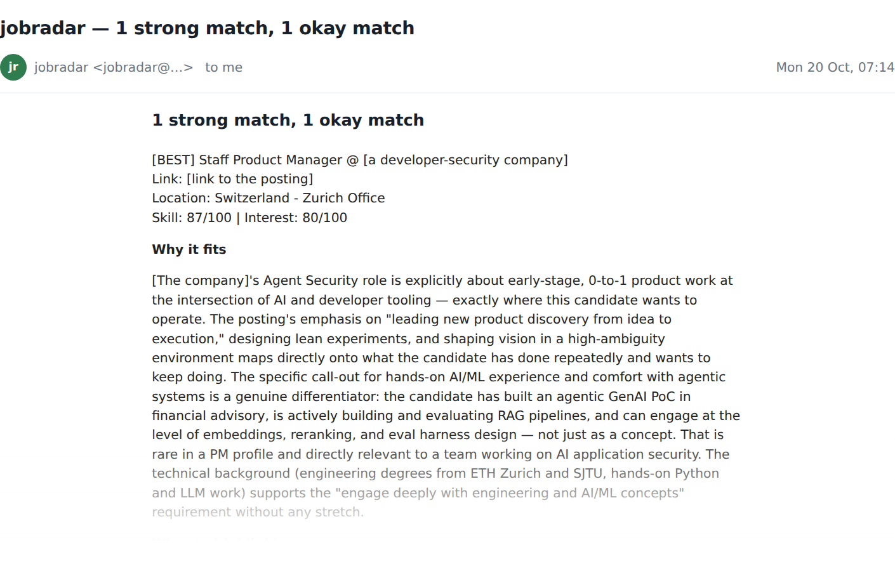
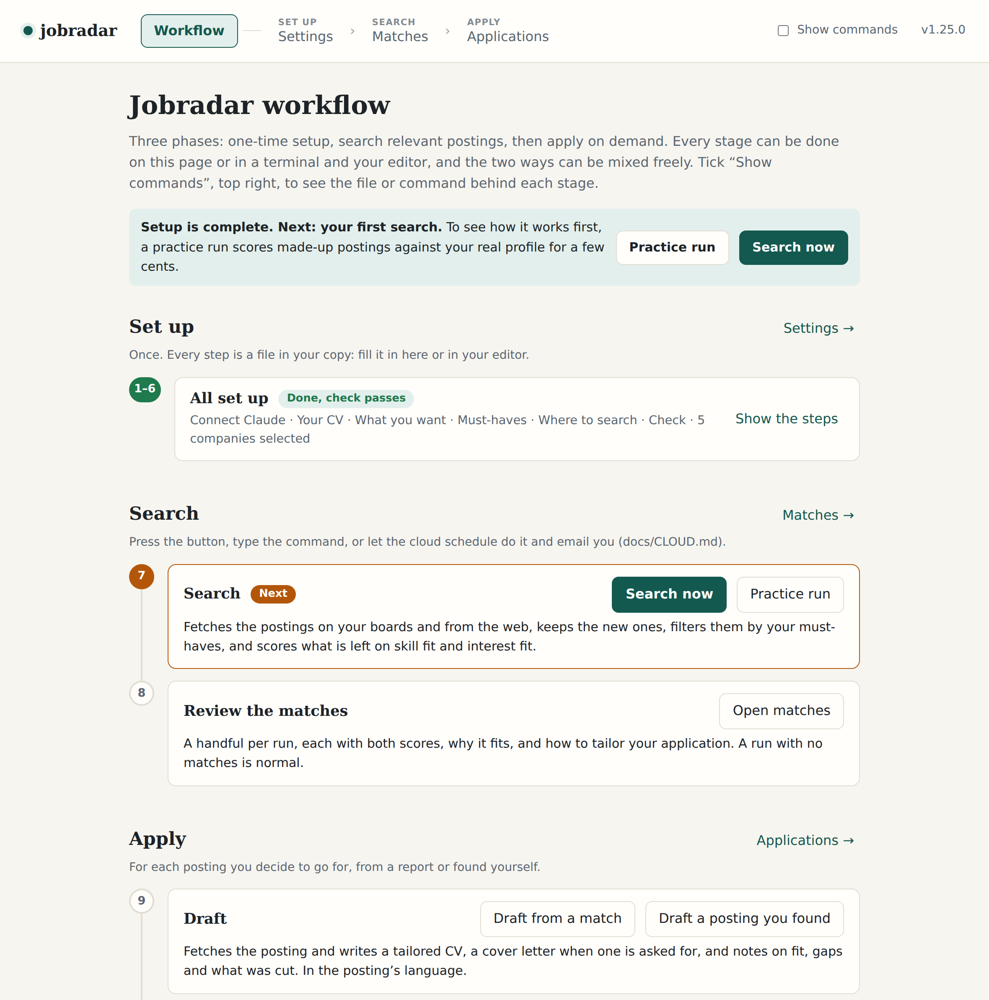

# jobradar

A job-search tool for Switzerland that reads every posting so you don't have
to. Instead of keyword alerts, it scores each posting on two things: **skill
fit** against your CV, and **interest fit** against a page you write about
what you actually want next. Hard requirements (canton, workload, office days)
are filtered out before any of that. You decide how much reaches you: only
postings that clear the skill and interest floors you set get through, up to
a number per day you also set, and a day with nothing is a normal day.

It finds postings itself: from the company career pages you choose (a
catalogue of 85 Swiss boards across twenty applicant-tracking systems ships
with it, grouped by industry, and none is scanned until you pick it), and from
Claude's web search. It never scrapes or automates aggregator sites such as
LinkedIn, where that is explicitly forbidden. When you decide to apply, it
drafts a tailored CV and cover letter in the posting's language, keeps a
submission log, and can prepare an interview sheet from your own stories.

## What it produces

One real run, from 20 October 2026. The selected boards and the web search
returned 4,028 open postings. 101 were new since the day before, 52 were in
the right place, 33 cleared the hard requirements and 30 were read in full.
Two reached the report, which arrives as an email:



Employers are replaced with a description, here and in the quotes below; the
wording is otherwise unchanged. Each match continues past the fold with what
to lead with from your CV and the concerns to expect in a screen — for the
one above, that its 0-to-1 track record is in wealthtech and PropTech rather
than the developer tooling the posting asks for.

What keeps the list to two is the pair of floors, `min_skill` and
`min_interest`. That morning they threw out two postings for opposite
reasons:

| Posting | Skill | Interest | |
| --- | ---: | ---: | --- |
| Staff Product Manager — a developer-security company | 87 | 80 | surfaced |
| Data Scientist P&C — a Swiss insurer | 70 | 40 | surfaced |
| Consultant, Forensic Technology — a Big Four firm | 92 | 15 | dropped |
| Lead AI Engineer, Agentic — a Swiss insurer | 52 | 72 | dropped |

The third scored higher on skill than anything that reached the report, and
a keyword alert would have led with it:

> Degree and English are met, but there is no eDiscovery tooling experience
> (Relativity, Nuix) in the profile. The role is forensic consulting and
> investigation support, not the hands-on data and AI product work the
> candidate is moving toward.

The fourth fails the other way — the kind of work the interest page asks
for, turned down because the skill side does not hold up:

> Strong fit on hands-on GenAI and product ownership, but the profile has no
> insurance or P&C underwriting background, and production
> agentic/LangChain/GCP experience is only partly evidenced. The role is a
> technical AI lead at an insurer, which suits the AI-layer interest, though
> insurance is not an aspiration.

Neither is a keyword problem, and one score could not have separated them.
The okay match above cleared `min_interest` by exactly nothing — 40 against
a floor of 40. Every posting a run scores is kept with its reasoning in
`reports/runs.jsonl`, matched or not, so you can tell a bad call from a
correct one and move the floors when they are wrong.

## In your browser, or in a terminal

Once it is installed, jobradar can be worked from a page in your browser:
`uv run python -m jobradar.ui`. The page opens on a map of the whole
workflow that shows where your copy stands and what to do next, here on a
new copy that is set up and about to run its first search:



From there you fill in the setup as forms, run a search, read the matches
with their reasoning, draft applications, edit them, and record what came
back. Every button runs the command the docs give for it and every form
writes the file you would otherwise edit, so the page and the terminal can be
mixed freely; **Show commands** puts the file or command under each stage.
Anything that costs money asks first. The page runs on your computer only and
leaves Git alone. [docs/UI.md](docs/UI.md) has the details.

## Who it is for

Anyone looking for a job in Switzerland who would rather read four good
matches than forty alerts. It is not tied to a field: matching is driven by
your CV and your own words, not by job titles, so it works for a product
manager, a lab technician or a controller alike. You need:

- An **Anthropic API key** (Claude does the reading). Nothing is hosted;
  the key stays on your machine or in your own GitHub repo.
- **Git**, **uv** and a terminal for the install, which is copy-paste. uv
  installs jobradar and the Python it needs; you don't need Python already.
  Step 2 installs uv. Git:
  - **Windows:** install [Git for Windows](https://git-scm.com/download/win).
  - **Mac:** the first `git` command offers to install Apple's command line
    tools, which include Git.
  - **Linux:** most distributions don't include it. Install it with
    `sudo apt install git` (Ubuntu, Debian) or `sudo dnf install git`
    (Fedora). This needs administrator rights: on Debian set up with a
    separate root password, use `su -c "apt install git"` instead, and on a
    computer someone else manages, ask them.

  After that you can work from the browser page or stay in the terminal.
  jobradar is tested on Windows 11 and on Linux (Ubuntu, Debian, Fedora). It
  should work the same way on a Mac, but no clean Mac install has been tested
  yet: if you try one, please say how it went in an
  [issue](https://github.com/YingzhiVA/jobradar/issues).
- Optionally a **GitHub account**, so the search runs every morning in the
  cloud and emails you, without your computer being on.

If you are registered with a **RAV** (regional unemployment office), there is
an optional mode that produces the monthly proof-of-applications table from
your submission log. Off by default.

## What it costs

You pay Anthropic for what the tool reads and writes; the tool itself is
free (MIT). What a run costs depends mostly on how many company boards you
select. Rough figures with the default models, from October 2026:

| Activity | About |
| --- | --- |
| A daily run with no boards selected (web search only) | $0.05–0.10 |
| A daily run on the author's setup of about 80 boards | $0.20 |
| One drafted application (CV + cover letter) | $0.25–0.45 |

**Your first run is the exception.** It treats every posting currently open
on the boards you chose as new, and scores all of those that pass your
constraints in one go. With every board in the catalogue selected that is
roughly $4–10, twenty to fifty times a normal day; with five or ten boards,
usually one to two dollars. That is why no board is selected out of the box:
start with five or ten, and add more a few at a time. [docs/COSTS.md](docs/COSTS.md) has the details and how to check your
own spend.

The quick start below has you make a dedicated API key with a monthly spend
limit, so the tool's usage shows on its own and cannot exceed what you chose.

## Quick start (about ten minutes)

1. **Get your copy.** In a terminal (PowerShell on Windows), one line at a
   time:

   ```bash
   git clone https://github.com/YingzhiVA/jobradar.git
   cd jobradar
   git remote rename origin upstream
   git config merge.ours.driver true
   git config pull.rebase false
   ```

   Your copy is on your computer, and your CV and application drafts stay
   there. The last three lines are what let you take updates later without
   ever touching your own files (see [Getting updates](#getting-updates)).
   No GitHub account is needed. For the daily run in the cloud you will put
   the copy in a private repo of your own; [docs/CLOUD.md](docs/CLOUD.md)
   shows how. It must be **private**, since it will hold your CV.
2. **Install.** If you don't have [uv](https://docs.astral.sh/uv/) yet,
   install it once, with the line for your system:

   **Windows**, in PowerShell:

   ```powershell
   powershell -ExecutionPolicy ByPass -c "irm https://astral.sh/uv/install.ps1 | iex"
   ```

   **macOS or Linux**, in a terminal:

   ```bash
   curl -LsSf https://astral.sh/uv/install.sh | sh
   ```

   If that says `curl: command not found` (Ubuntu and Debian don't always
   have it), use `wget -qO- https://astral.sh/uv/install.sh | sh` instead.

   Then open a new terminal (so it finds uv), go back into the `jobradar`
   folder, and run:

   ```bash
   uv sync
   ```

   That installs jobradar and everything it needs in a `.venv` folder inside
   your copy, and downloads a suitable Python first if your computer lacks
   one. Every command from here on starts with `uv run`, and is the same on
   every system.

   *Prefer pip?* With Python 3.11 or newer installed, run
   `python -m venv .venv`, then `.venv/bin/python -m pip install --upgrade pip`,
   then `.venv/bin/pip install -e ".[dev]"`. Upgrade pip first: an older pip
   on too old a Python doesn't refuse, it spends hours trying package
   versions. From then on, wherever this README says `uv run python`, use
   `.venv/bin/python`. On Windows the paths are `.venv\Scripts\` instead of
   `.venv/bin/`.
3. **Get a Claude API key.** Sign in to the [Claude
   Console](https://platform.claude.com/), add some credit under **Billing**
   (a new account has none, and $10 covers your first run and more than a
   week of daily runs), then create a key under **API keys**.
   Name it `jobradar` and set a monthly spend limit, so its usage shows on
   its own and can never exceed what you chose. Copy the key when it is
   shown: it starts with `sk-ant-`, and the Console won't show it again.

   From here there are two ways to do the rest, and you can mix them:

   - **In your browser.** Run `uv run python -m jobradar.ui`. It opens a
     map of the whole workflow that walks you through steps 4 to 8 with forms
     and buttons, and shows the file or command behind each one, so you can
     switch to the terminal at any point. See [docs/UI.md](docs/UI.md).
   - **In a terminal and your editor.** Read on.
4. **Add your key.** Copy the template and paste your key from step 3 into
   it, after `ANTHROPIC_API_KEY=`:

   ```bash
   cp .env.example .env
   ```

   `.env` stays on your computer; Git ignores it.
5. **Tell it who you are.** Two files, both Markdown:
   - `profile/cvs/` — add your CV as a `.md` file (one per role type if you
     have several), then delete `example.md`. A Word CV (`.docx`) works too:
     drop it in and the setup check in step 8 makes the Markdown for you.

     **Use your full base CV, not one you trimmed for an earlier
     application.** Everything reads from it. Skill fit is scored against it.
     When you apply, the tailored CV is made by cutting bullets from it for
     that one posting, and nothing is ever added that it doesn't contain.
     Experience left out here can't earn a match and can't appear in an
     application. So include every role, project and skill you would want
     considered, and write each bullet as well as you can. Tailoring picks
     bullets, reorders them and matches their wording to the posting, but it
     won't fix a weak one. If you keep one CV per role type, each one should
     still cover all your experience. They should differ in emphasis, not in
     what they leave out.
   - `profile/identity.md` — replace the template with a real page about what
     you are moving toward and away from. This drives interest fit; vague
     text gets vague scores.
6. **Tell it what is non-negotiable** in `config/constraints.yaml`: cantons,
   workload range, office days. The shipped example is three cantons around
   Zürich.
7. **Pick the company boards to scan.** None are selected.
   `config/boards/` lists the boards jobradar knows: `ch.yaml` for
   Switzerland, grouped by industry with the list of sections at the top,
   and `global.yaml` for big employers whose one board serves every country.
   Add the name of each board you want to `config/companies.yaml`, one per
   line.
   **Start with five or ten**: your first run scores every open
   posting on the boards you chose, so it costs far more than a normal day
   (see [What it costs](#what-it-costs)). You can add more later, a few at a
   time. The web search runs alongside your boards whatever you pick, and
   looks for roles that fit your profile at any company, so matches can come
   from companies you never listed; each match says where it was found.
   With no boards chosen, only the web search runs.
8. **Check the setup**, then do a dry run (real Claude calls on sample
   postings, no live sources), then a real one:

   ```bash
   uv run python -m jobradar.doctor
   uv run python -m jobradar.search.main --dry-run
   uv run python -m jobradar.search.main
   ```

   The report lands in `reports/<date>.md`; the dry run's goes to
   `reports/practice.md`, and it changes nothing a real run relies on or
   that git tracks. Read a few
   real runs before you trust the schedule.

Everything else is optional and explained in the docs below: steering how
many matches you see, the cloud schedule, the apply pipeline.

## Getting updates

Your copy doesn't update itself. New releases are listed on the [releases
page](https://github.com/YingzhiVA/jobradar/releases), and
[CHANGELOG.md](CHANGELOG.md) says what each one changed. To take one, in
your copy's folder:

```bash
git add -A
git commit -m "My setup and results"
git pull upstream master
uv sync
```

The first two lines record your own changes (your CV, `identity.md`, your
settings, applications and results), so the update can keep them: the
settings from quick start step 1 make every update leave those files as you
have them. "Nothing to commit" is fine. If git asks who you are, give it any
name and email, for this copy only:
`git config user.name "jobradar"` and
`git config user.email "jobradar@localhost"`. The last line picks up any new
package a release needs (with pip: `.venv/bin/pip install -e ".[dev]"`).

The setup check (`jobradar.doctor`) says whether your copy is set up for
updates, and the "Get updates" task on the browser page shows the commands
for where your copy stands.

**Made your copy with "Use this template"?** That was the README's way up to
1.28. Such a copy has a history of its own, so it needs this once instead
(after committing your changes as above):

```bash
git config merge.ours.driver true
git config pull.rebase false
git remote add upstream https://github.com/YingzhiVA/jobradar.git
git fetch upstream
git merge --allow-unrelated-histories -X theirs upstream/master
```

Run the first line before the merge, never skip it: it is what keeps your
files. The merge takes the public version of every program file (`-X
theirs`), so any change you made to jobradar's own code is replaced. After
that, updates work as above.

## How it fits together

Three phases, each its own module, sharing the profile you set up once:

1. **Company discovery** (`jobradar.discovery`), occasional: find companies
   worth scanning and feed them into `config/companies.yaml`. Optional; the
   shipped catalogue in `config/boards/` already covers 85 boards for
   Switzerland.
2. **Search** (`jobradar.search`), the daily run: fetch postings, filter,
   score, report the few worth your time.
3. **Apply** (`jobradar.apply`), on demand: turn chosen postings into
   tailored CV and cover-letter folders, plus interview prep and a submission
   log.

A posting that came from a daily report reuses that report's analysis when
you apply, so nothing is paid for twice.

## Documentation

- [docs/SETUP.md](docs/SETUP.md) — the profile in full, credentials, how
  updates leave your own files alone
- [docs/UI.md](docs/UI.md) — the browser interface: the workflow on one
  page, as an alternative to the terminal for daily use
- [docs/SEARCH.md](docs/SEARCH.md) — the daily run: configuration dials, how
  a run works, the report and run log
- [docs/CLOUD.md](docs/CLOUD.md) — the GitHub Actions schedule and email
- [docs/APPLY.md](docs/APPLY.md) — drafting applications, linting, PDFs,
  outcomes, the optional RAV table
- [docs/DISCOVERY.md](docs/DISCOVERY.md) — finding more companies to scan
- [docs/COSTS.md](docs/COSTS.md) — what it spends and how to cap it
- [docs/DEVELOPING.md](docs/DEVELOPING.md) — tests, adding a source
- [docs/ROADMAP.md](docs/ROADMAP.md) — what is deliberately not built yet
- [CHANGELOG.md](CHANGELOG.md) — what changed between versions

## Feedback

Two kinds are especially welcome:

- **Companies to add.** A company you would like scanned that the catalogue
  lacks, or a board in it that stopped answering: its name and the address
  of its careers page are enough. If you already added it to your own
  `config/companies.yaml` with an `ats` and a `slug`, include those, and it
  can go into the shared catalogue for everyone. [Open an
  issue](https://github.com/YingzhiVA/jobradar/issues), as for a bug.
- **Ideas and impressions**: a setup step that confused you, a match that
  should not have reached you (or one that should have), something you wish
  it did. Post them under [Ideas in the
  discussions](https://github.com/YingzhiVA/jobradar/discussions/categories/ideas),
  where others can add to them.

Or get in touch through the contact details on the maintainer's [GitHub
profile](https://github.com/YingzhiVA). Issues and discussions are public:
leave your CV, your identity page and anything else personal out of them.

## Tests

```bash
uv run pytest
```

No API key needed: the tests cover the deterministic parts (filters,
ranking, normalisation, config, the apply bookkeeping) with fixtures.

## License

MIT. The name is a description, a radar for jobs; it is not affiliated with
any job board that happens to use a similar one.
